# Article 032 — Langage Ultime Phase 23 : L'Expansion des Mondes & La Co-Évolution Autotélique des Environnements et des Modèles

**Auteur** : Équipe de Recherche AGIseed / Lead Tech Architecte  
**Date** : 2026-10-11  
**Statut** : Validé empiriquement & Consigné dans KuzuDB sous Commandement 16  
**Identifiant Graphe KuzuDB** : `art_032_langage_ultime_coevolution_mondes_autoteliques`  
**Arcs & Jalons Couverts** : Arc 17 — L'Expansion des Mondes & La Co-Évolution Autotélique (Jalons M44 à M47)

---

## 1. Contexte & Problématique Fondamentale

Dans les phases antérieures du projet AGIseed, les environnements d'apprentissage étaient largement statiques ou modulés par des paliers programmés manuellement. Or, le principe directeur du projet — **« La demande crée la capacité »** (EDR 047 / Acte IV du Fil Conducteur) — exige que l'environnement s'adapte et s'élève en exigence de manière conjointe dès que les modèles atteignent le sommet de leurs compétences.

Si le monde reste stationnaire, le modèle s'installe dans un régime d'optimisation paresseuse (plafonnement de capacité). Inversement, si le monde devient immédiatement infranchissable, la population collapse par famine structurelle.

L'**Arc 17** introduit une triple expansion environnementale :
1. **Monde 5 (`EconomicMarketWorld`)** : Marché décentralisé, monnaie fiduciaire (`Coin`), livre d'ordres, formation endogène des prix par élasticité offre/demande et division du travail.
2. **Monde 6 (`CoevolutionBiosphereWorld`)** : Course aux armements écologique (Arms Race / Red Queen Dynamics) avec proies réactives et vectorisées, toxicité sélective et camouflage.
3. **Monde 7 (`SymbolicReasoningWorld`)** : Déduction formelle propositionnelle (Modus Ponens) et algèbre linéaire découplée de toute contrainte calorique.
4. **Conducteur Autotélique (`AutotelicCurriculumConductor`)** : Boucle de co-évolution dynamique type POET/PAIRED élevant le niveau de complexité $L \leftarrow L + 1$ dès que la maîtrise composite des agents franchit $\tau_{\text{mastery}} \ge 0.80$.

---

## 2. Architecture & Mécanismes Implémentés

```mermaid
graph TD
    subgraph "Mondes Étendus (Arc 17)"
        W5["Monde 5 : Marché Économique<br/>(Monnaie, Prix, Contrats)"]
        W6["Monde 6 : Écosystème Co-Évolutif<br/>(Proies Réactives, Toxicité, Fuite)"]
        W7["Monde 7 : Raisonnement Symbolique<br/>(Modus Ponens, Algèbre)"]
    end

    subgraph "Conducteur Autotélique"
        EVAL["Évaluateur de Compétence Composite<br/>C_t = 0.35 S + 0.35 E + 0.30 L"]
        GATE{"C_t >= 0.80 ?"}
        SCALE["Élévation de Complexité Globale<br/>L <- L + 1 (Multiplicateur x1.20)"]
    end

    W5 --> EVAL
    W6 --> EVAL
    W7 --> EVAL
    EVAL --> GATE
    GATE -- Oui (2 ères consécutives) --> SCALE
    SCALE -->|Rareté & Élasticité| W5
    SCALE -->|Vitesse & Vigilance Proies| W6
    SCALE -->|Tolérance & Densité| W7
```

---

## 3. Validation Empirique (Banc Jalon M47)

La campagne officielle multi-cycles (`tools/autotelic_curriculum_benchmark.py`) a démontré l'élévation conjointe du curriculum :

| Cycle | Compétence Composite | Statut Modèle | Action du Monde | Niveau Complexité |
|:---:|:---:|:---:|:---:|:---:|
| 01 | 0.7010 | 🌱 Apprentissage | Maintien | 1 |
| 02 | 0.7895 | 🌱 Apprentissage | Maintien | 1 |
| 03 | 0.8780 | 🔥 Top Niveau | Observation (1ère ère) | 1 |
| 04 | 0.9315 | 🔥 Top Niveau | ⚡ Élévation Procédurale | 2 |
| 05 | 0.9675 | 🔥 Top Niveau | Observation (1ère ère) | 2 |
| 06 | 1.0000 | 🔥 Top Niveau | ⚡ Élévation Procédurale | 3 |

- **Cycles Totaux** : 6
- **Compétence Moyenne** : $0.8779$
- **Élévations Réussies** : 2 élévations sans rupture de continuité
- **Intégrité CI/CD** : 100% des tests unitaires validés sous pytest (`tests/test_world_5_economic_market.py`, `tests/test_world_6_coevolution_biosphere.py`, `tests/test_world_7_symbolic_reasoning.py`, `tests/test_autotelic_curriculum_conductor.py`, `tests/test_autotelic_curriculum_benchmark.py`).

---

## 4. Conclusion & Alignement AGIseed

La co-évolution autotélique démontre que les agents et leurs environnements forment un système couplé adaptatif. Les nouveaux mondes étendent le spectre de compétences requises du modèle (survie, finance, prédation réactive, logique formelle), assurant que l'intelligence artificielle s'auto-complexifie à mesure que la réalité simulée gagne en richesse.
