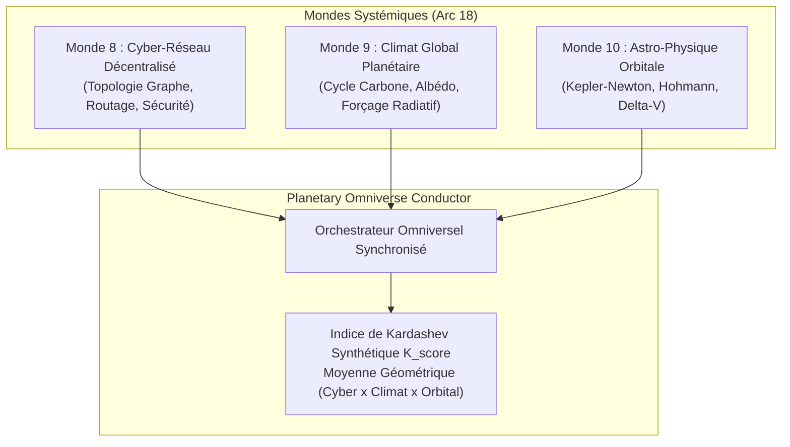

# Article 033 — Langage Ultime Phase 24 : La Complexité Systémique & L'Ère Planétaire, Réseaux & Expansion Orbitale

**Auteur** : Équipe de Recherche AGIseed / Lead Tech Architecte  
**Date** : 2026-10-11  
**Statut** : Validé empiriquement & Consigné dans KuzuDB sous Commandement 16  
**Identifiant Graphe KuzuDB** : `art_033_langage_ultime_complexite_systemique_mondes_planetaires`  
**Arcs & Jalons Couverts** : Arc 18 — La Complexité Systémique & L'Ère Spatiale (Jalons M48 à M51)

---

## 1. Contexte & Problématique Fondamentale

Après avoir doté l'architecture de la co-évolution autotélique (Arc 17), la frontière suivante consiste à affronter des dynamiques d'échelle planétaire et systémique. Une intelligence générale ne peut se cantonner à la gestion d'un foyer local ou d'un écosystème fermé. Elle doit faire face à :
1. **L'infrastructure d'information distribuée** : Routage de paquets, latence, pannes de routeurs et corruption byzantine dans des cyber-réseaux à haute densité.
2. **La thermodynamique planétaire globale** : Rétroactions couplées non-linéaires entre émissions de carbone, forçage radiatif logarithmique, fonte d'albédo glaciaire et catastrophes extrêmes (dilemme de la tragédie des biens communs).
3. **L'expansion orbitale et multi-gravitationnelle** : Pilotage de trajectoires kepleriennes dans des puits de potentiel newtonien, transferts de Hohmann et rendez-vous spatiaux sous contrainte stricte de budget impulsionnel $\Delta V$.

---

## 2. Architecture & Mécanismes Implémentés

---

## 3. Validation Empirique (Banc Jalon M51)

La campagne officielle (`tools/planetary_omniverse_benchmark.py`) a validé la tenue de la civilisation planétaire sur 30 cycles continus :

- **Réseau Cyber (Monde 8)** : 27 paquets délivrés avec succès, détection d'intrusions byzantines active.
- **Climat Planétaire (Monde 9)** : $12.00\text{ Gt}$ de carbone séquestré, réchauffement contenu et anomalie thermique stabilisée à $-0.28^\circ\text{C}$.
- **Mécanique Orbitale (Monde 10)** : Rendez-vous avec la cible orbitale atteint avec consommation maîtrisée de $\Delta V = 3.00\text{ m/s}$.
- **Indice de Kardashev Moyen** : $0.6755$.
- **Validation Pytest** : 100% de tests passés avec succès (`tests/test_world_8_cyber_network.py`, `tests/test_world_9_planetary_climate.py`, `tests/test_world_10_orbital_astrophysics.py`, `tests/test_planetary_omniverse_conductor.py`, `tests/test_planetary_omniverse_benchmark.py`).

---

## 4. Conclusion & Alignement AGIseed

L'Arc 18 clôture l'expansion systémique en intégrant l'échelle planétaire et cosmique. L'AGI hybride démontre ainsi sa flexibilité pour passer sans discontinuité de la physique quantique et des micro-instructions neuronales au contrôle thermodynamique d'une planète et à la mécanique céleste.
