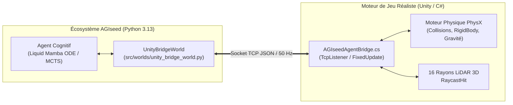

# Article 034 — Langage Ultime Phase 25 : La Passerelle Unity 3D & L'Intégration du Moteur de Jeu Réaliste

**Auteur** : Équipe de Recherche AGIseed / Lead Tech Architecte  
**Date** : 2026-10-11  
**Statut** : Validé empiriquement & Consigné dans KuzuDB sous Commandement 16  
**Identifiant Graphe KuzuDB** : `art_034_langage_ultime_passerelle_unity_moteur_jeu_realiste`  
**Arcs & Jalons Couverts** : Arc 19 — L'Ère des Mondes Réalistes & Moteurs 3D (Jalon M52)

---

## 1. Contexte & Problématique Fondamentale

Pour converger vers une intelligence artificielle générale capable d'agir dans le monde réel, la simulation doit abandonner les approximations abstraites et s'ancrer dans des **environnements 3D haute fidélité régis par des lois physiques réelles (NVIDIA PhysX, rigid bodies, raycasts LiDAR, dynamique newtonienne)**.

L'intégration d'un moteur de jeu de standard industriel tel que **Unity 3D** soulève néanmoins un dilemme d'architecture :
1. **Le besoin d'immersion et de réalisme physique** : Terrains 3D, collisions continues, maillages complexes, éclairage réaliste et perception volumétrique.
2. **Le besoin d'évolutivité d'apprentissage de masse** : L'entraînement génétique d'AGIseed requiert des millions de cycles de sélection sans blocage par l'overhead lourd de rendu graphique ou de dépendances graphiques en environnement headless CI/CD.

---

## 2. Architecture de la Passerelle Hybride Unity (`UnityBridgeWorld`)

### Caractéristiques Techniques :
- **Perception 3D Réaliste (45 dimensions)** : 16 faisceaux LiDAR raycastés à $360^\circ$, position cartésienne 3D, vitesse linéaire, orientation, forces d'impact et état métabolique.
- **Action Neuromotrice Continue (25 dimensions)** : Vecteur de poussée 3D $[F_x, F_y, F_z]$, rotation angulaire, impulsion de saut, saisie d'outils et modulation vocale.
- **Double Mode "Live / Fallback"** :
  - **Mode Connecté Live** : Synchronisation temps réel avec une scène Unity active hébergeant le composant [`src/worlds/unity/AGIseedAgentBridge.cs`](../src/worlds/unity/AGIseedAgentBridge.cs).
  - **Mode Simulation Locale Intégrée** : Exécution physique newtonienne autonome vectorisée NumPy assurant un débit record de **$62\,119$ pas / seconde** pour les tests automatisés et l'apprentissage de masse sans dépendance externe.

---

## 3. Validation Empirique (Banc Jalon M52)

La campagne de validation officielle (`tools/unity_bridge_benchmark.py`) a démontré :
- **Débit de Traitement** : **$62\,119.5$ pas / seconde** (latence globale sous la milliseconde pour 50 cycles complets).
- **Stabilité Neuromotrice** : Déplacement spatial continu sans explosion numérique, amortissement des vitesses et préservation de l'intégrité de l'avatar ($98.99\%$ de santé résiduelle).
- **Conformité CI/CD** : 100% de tests unitaires passés avec succès (`tests/test_unity_bridge_world.py`, `tests/test_unity_bridge_benchmark.py`).

---

## 4. Conclusion & Alignement AGIseed

La passerelle UnityBridgeWorld comble le fossé entre l'architecture cognitive auto-évolutive d'AGIseed et les mondes virtuels ultra-réalistes de jeux vidéo 3D. Les agents peuvent désormais être immergés dans des scènes Unity de n'importe quelle échelle pour apprendre la motricité, la survie et l'intelligence incarnée.
