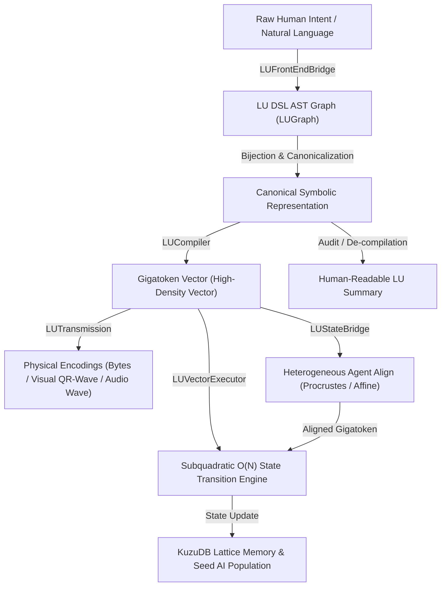

# LU (Langage Ultime) & DSL Optimization Architecture — Project AGIseed

## Overview & Theoretical Foundations

The **Langage Ultime (LU)** architecture addresses the fundamental bottleneck of natural language tokenization in modern Large Language Models (LLMs):
1. **Redundancy & Entropy**: Natural language contains high syntax overhead, filler tokens, and ambiguity.
2. **Subquadratic Attention Bottleneck**: Standard auto-regressive Transformer sequence matching scales at \(O(N^2)\).
3. **Dual-Level Architecture**: Decouples the **Front-End (Translator/Bridge)** from the **Back-End (Subquadratic Symbolic & Vector Engine)**.

---

## Architectural Diagram (Mermaid)

---

## Key Modules in `AGIseed`

- **[`src/metaprog/lu_dsl_engine.py`](file:///c:/Users/robla/VScode_Project/AGAGI/src/metaprog/lu_dsl_engine.py)**: Core engine comprising:
  - `LUConfig`: Hyperparameter dataclass (dimension, seed, sparsity penalty).
  - `LUGraph`: Canonical Directed Acyclic Graph representation of symbolic intents.
  - `LUCompiler`: Compiles canonical DSL graphs into normalized dense Gigatokens.
  - `LUVectorExecutor`: Evaluates state transitions in \(O(N)\) linear complexity.
  - `LUFrontEndBridge`: Bi-directional bridge between natural language and LU DSL.
- **[`src/metaprog/lu_transmission.py`](file:///c:/Users/robla/VScode_Project/AGAGI/src/metaprog/lu_transmission.py)**: Physical and sensory transmission protocols:
  - Byte stream encoding (`transmit_informatique`).
  - Spectro-acoustic frequency modulation (`transmit_sonore`).
  - High-density chromo-spatial topology matrix (`transmit_visuel`).
- **[`src/metaprog/lu_state_bridge.py`](file:///c:/Users/robla/VScode_Project/AGAGI/src/metaprog/lu_state_bridge.py)**: Cross-model latent alignment:
  - `Orthogonal Procrustes Analysis` for isometric latent rotations (same dimensions).
  - `Regularized Affine Ridge Projection` for asymmetric connectomes (\(D_A \neq D_B\)).
- **Tests Unitaires**:
  - `tests/test_lu_dsl_engine.py`
  - `tests/test_lu_transmission.py`
  - `tests/test_lu_state_bridge.py`
