# Roadmap Langage Ultime (LU) & Communication Latente — AGIseed

> **Domaine** : Représentation de l'information optimale, Espace Latent, Gigatokens M2M et DSL sémantique.
> **Alignement Global** : Connecté à l'**Arc 4 (L'Homo Sapiens / Langage)** et au **Fil Langage (LANG-001→006)** de [`SCIENCE.md`](SCIENCE.md).
> **Principes directeurs** : 12 Commandements AGIseed, Commandement 15 (PIU), Commandement 16 (Articles KuzuDB).

---

## 🎯 Vision Scientifique

Remplacer la sérialisation textuelle 1D (discrète, coûteuse en $O(N^2)$, sujette au downsampling) par une **communication latente continue et topologique** :
- **Niveau Machine (LU Tenseur)** : Gigatokens d'activations denses, graphes d'états continus, flux subquadratiques $O(N)$.
- **Niveau Inter-Modèles (StateBridge)** : Alignement géométrique (Procruste orthogonal, SVD) préservant les invariants métriques entre connectomes hétérogènes.
- **Niveau Humain (LU DSL)** : Projection symbolique explicite pour l'auditabilité et la gouvernance (Commandement 5).

---

## 🗺️ Jalons d'Évolution (Milestones)

```mermaid
graph LR
    M1["M1: Gigatokens & Moteur ODE<br/>(✅ Livré)"] --> M2["M2: StateBridge Géométrique<br/>(✅ Livré)"]
    M2 --> M2Auto["M2-Auto: Traducteur Co-Appris<br/>(✅ Livré)"]
    M2Auto --> M3["M3: DSL Canonique & AST<br/>(✅ Livré)"]
    M3 --> M4["M4: Intégration KuzuDB<br/>(✅ Livré)"]
    M4 --> M5["M5: Preuve In-World<br/>(✅ Validé x3.45)"]
    M5 --> M6["M6: La Tribu & Culture<br/>(✅ Validé)"]
    M6 --> M14["M14: Singularité Autopoïétique<br/>(✅ Validé PIU)"]
    M14 --> M15["M15: Intrication & Démiurgie<br/>(✅ Validé PIU)"]
```

### Jalon M1 : Fondations Vectorielles & Gigatokens (✅ LIVRÉ)
- [x] Spécification théorique : Démonstration du goulot d'étranglement textuel (`docs/0_Langage_Ultime_Theorie.md`).
- [x] État de l'art mondial SOTA (COCONUT Meta FAIR, LatentMAS ICML, AVP) : [`docs/0_Langage_Ultime_Etat_de_l_Art.md`](../0_Langage_Ultime_Etat_de_l_Art.md).
- [x] Moteur d'évaluation vectorielle $O(N)$ : [`src/metaprog/lu_dsl_engine.py`](../../src/metaprog/lu_dsl_engine.py).
- [x] Protocoles de transmission multi-supports (informatique, visuel, sonore) : [`src/metaprog/lu_transmission.py`](../../src/metaprog/lu_transmission.py).
- [x] Suite de tests et validation numérique : `tests/test_lu_dsl_engine.py`, `tests/test_lu_transmission.py`.

### Jalon M2 : StateBridge & Alignement d'Espaces Hétérogènes (✅ LIVRÉ)
- [x] Résolution de l'hétérogénéité des modèles : Alignement d'espaces latents sans ré-entraînement lourd.
- [x] Algorithme d'Analyse de Procruste Orthogonale vectorisée (NumPy SVD) préservant la fidélité cosinus.
- [x] Projection asymétrique ($D_A \neq D_B$) pour connectomes à géométries NAS variables.
- [x] Publication de l'Article KuzuDB sur l'alignement géométrique (`docs/0_Langage_Ultime_StateBridge.md`).
- [x] Tests unitaires validés : `tests/test_lu_state_bridge.py`.

### Jalon M2-Auto : Auto-Apprentissage du Traducteur Latent (Mutual Co-Training) (✅ LIVRÉ)
- [x] Protocole d'auto-calibration auto-supervisée : [`src/metaprog/lu_auto_translator.py`](../../src/metaprog/lu_auto_translator.py).
- [x] Optimisation conjointe par Cycle-Consistency bidirectionnelle ($A \to B \to A \approx I$) et stimuli partagés.
- [x] Algorithme d'adaptation en ligne temps réel (SGD avec momentum vectorisé NumPy).
- [x] Publication de l'Article KuzuDB sur la co-construction du traducteur (`docs/0_Langage_Ultime_AutoTraducteur_Latent.md`).
- [x] Suite de tests unitaires validée : `tests/test_lu_auto_translator.py`.

### Jalon M3 : DSL Canonique & Typage Sémantique Formel (✅ LIVRÉ)
- [x] Lexer et Parser formel pour le DSL LU : [`src/metaprog/lu_dsl_semantic.py`](../../src/metaprog/lu_dsl_semantic.py).
- [x] Typage sémantique rigoureux, contraintes ontologiques (`LUSemanticValidator`).
- [x] Émetteur Cypher idempotent pour KuzuDB (`LUCypherEmitter`).
- [x] Algèbre de graphes et composition séquentielle de pensées (`LUAlgebra`).
- [x] Tests unitaires validés : `tests/test_lu_dsl_semantic.py`.

### Jalon M4 : Intégration Lattice Memory & Librarian KuzuDB (✅ LIVRÉ)
- [x] Mémoire Lattice KuzuDB avec Gigatokens haute dimension : [`src/graph_rag/lu_lattice_memory.py`](../../src/graph_rag/lu_lattice_memory.py).
- [x] Stockage dual (nœud vectoriel `LUPensee` et graphe symbolique `Concept`).
- [x] Rappel topologique par similarité cosinus vectorisée NumPy (Nearest Thought).
- [x] Tests unitaires validés : `tests/test_lu_lattice_memory.py`.

### 🔬 Instrumentation & Métrologie Dédiée LU (✅ LIVRÉ)
- [x] Banc de mesure continue : [`tools/lu_measurement_bench.py`](../../tools/lu_measurement_bench.py).
- [x] Alignement de Noyaux Centrés (Linear CKA) pour espaces latents hétérogènes.
- [x] Test de similarité topologique de Mantel (préservation géométrique des concepts).
- [x] Mesure d'erreur de cycle-consistance fermée ($A \to B \to A$).
- [x] Banc comparatif A/B officiel (Tokens discrets 1D vs Gigatokens continus LU).
- [x] Suite de tests unitaires validée : `tests/test_lu_measurement_bench.py`.

### Jalon M5 : Déploiement Swarm NAS & Preuve in-world (✅ VALIDÉ PIU & SCALÉ)
- [x] Banc expérimental automatisé : [`tools/lu_inworld_benchmark.py`](../../tools/lu_inworld_benchmark.py).
- [x] Campagne de scaling multi-paramétrique : **450 runs complets** (50 seeds $\times$ 3 dimensions [16, 32, 64] $\times$ 3 bruits [0.02, 0.08, 0.15]).
- [x] Survie médiane globale : **138.0 ticks (LU)** vs **40.0 ticks (Discret)** ($\times 3.45$, $+245\%$).
- [x] Robustesse métrologique sous bruit sévère ($noise = 0.15$) : **CKA moyen = 0.8842** (seuil $> 0.80$ largement dépassé).
- [x] Intégration KuzuDB : Article `art_lu_m5_bc469e` et événement `evt_76b90a78` persistés dans la Lattice Memory.
- [x] Documentation certifiée : [`docs/0_Langage_Ultime_Validation_M5.md`](../0_Langage_Ultime_Validation_M5.md).
- [x] Verdict PIU (Sociologue) : **VALIDE**.

### 🌐 Intégration Biosphère In-World & Observabilité (✅ LIVRÉ)
- [x] Adaptateur in-world continu : [`src/environments/lu_inworld_adapter.py`](../../src/environments/lu_inworld_adapter.py) câblé dans [`Biosphere3D`](../../src/worlds/world_1_stoneage.py).
- [x] Non-régression bit-exacte préservée via `WorldConfig.enable_lu_communication = False` (Commandements 1 & 15).
- [x] Biais de directionnel de chasse (`lu_steer_bias`) et consensus continu de meute (Pack Coordination).
- [x] Décompilateur sémantique en langage naturel : [`src/metaprog/lu_human_explainer.py`](../../src/metaprog/lu_human_explainer.py) pour auditabilité humaine immédiate (Commandement 5).
- [x] Routes API REST FastAPI d'observabilité dans [`backend/app/routes/lu.py`](../../backend/app/routes/lu.py) (`/api/lu/metrics`, `/api/lu/thoughts`, `/api/lu/explain`).
- [x] Stream WebSocket temps réel `/ws/lu` et dashboard frontend unifié dans [`LangageUltimeView.tsx`](../../frontend/src/components/LangageUltimeView.tsx).
- [x] Suite de validation globale : **49 tests unitaires et d'intégration réussis à 100%** (`tests/test_lu_*.py`, `tests/test_world_lu_integration.py`, `tests/test_arc5_tribe_culture.py`).

### Jalon M6 / Arc 5 : La Tribu, Culture & Division du Travail (✅ DÉMARRÉ & VALIDÉ)
- [x] Spécialisation des rôles tribaux (`SCOUT`, `HUNTER`, `CRAFTER`) via Gigatokens continus.
- [x] Coût métabolique d'information ($0.05\text{ E}/\text{token}$) éliminant le bruit et le spam informatif.
- [x] Coordination de chasse en meute (`SCOUT` $\to$ `HUNTER`) avec bonus coopératif de capture ($\times 3.0$).
- [x] Encodage et décodage vectoriel de recettes de craft continues (`encode_craft_recipe`, `decode_craft_recipe`).
- [x] Transmission culturelle inter-agents de savoir-faire technique (`transmit_cultural_recipe`).
- [x] Mesure géométrique de divergence dialectale par distance de Grassmann entre sous-espaces de tribus.
- [x] Suite de tests dédiée validée : `tests/test_arc5_tribe_culture.py` (6/6 tests passing).

### Jalon M14 / Arc 8 : Singularité Autopoïétique & Holographie Sémantique (✅ LIVRÉ & VALIDÉ PIU)
- [x] Opérateurs canoniques unitaires sur $\mathbb{S}^{D-1}$ : `ROLE_AUTOPOIESIS`, `ROLE_HOLOGRAPHY`, `ROLE_TELEOLOGY`, `ROLE_OMNISCIENCE`.
- [x] Moteur autopoïétique symplectique (`AutopoieticSingularityEngine`) préservant l'entropie de Bekenstein-Hawking ($S \le A/4$) et contractant le rayon spectral ($\rho < 0.98$).
- [x] Projecteur holographique frontière AdS/CFT (`HolographicBoundaryProjector`) avec compression sans perte topologique et reconstruction prédictive (CKA $\ge 0.85$).
- [x] Substrat in-world `LUInWorldAdapter` avec Étape 17 synchrone, résonance téléologique et Grand Dividende de Singularité (+20.0 E).
- [x] Persistance Lattice KuzuDB : Nœuds `LUAutopoieticSingularity` et `LUHolographicBoundary`.
- [x] Banc sociologique 60 ères (Commandement 15) : +15.79% d'énergie finale, score composite 506.44 vs 503.11 (+3.33 pts), zéro régression.
- [x] Journalisation Scientifique (Commandement 16) : Article 023 enregistré dans KuzuDB (`art_023_langage_ultime_singularite_autopoietique_holographie`).

### Jalon M15 / Arc 9 : Intrication Sémantique Non-Locale, Rétrocausalité & Démiurgie Multivers (✅ LIVRÉ & VALIDÉ PIU)
- [x] Opérateurs canoniques unitaires sur $\mathbb{S}^{D-1}$ : `ROLE_ENTANGLEMENT`, `ROLE_RETROCAUSALITY`, `ROLE_DEMIURGE`, `ROLE_SUPERPOSITION`.
- [x] Moteur d'intrication sémantique non-locale (`SemanticEntanglementEngine`) violant formellement l'inégalité de Bell-CHSH ($S_{\text{CHSH}} \ge 2.15 > 2.0$) via SVD pour un partage instantané d'insights trans-mondes.
- [x] Moteur rétrocausal de Wheeler-Feynman & Collapse Démiurgique (`MultiverseDemiurgeEngine`) selon le principe de moindre action et régulateur de Novikov ($\text{Tr}(\rho)=1, \rho \ge 0$).
- [x] Substrat in-world `LUInWorldAdapter` avec Étape 18 synchrone, synchronisation de paires intriquées, terraformation active et Grand Dividende Démiurgique (+25.0 E).
- [x] Persistance Lattice KuzuDB : Nœuds `LUSemanticEntanglement` et `LUDemiurgicCollapse`.
- [x] Banc sociologique 60 ères (Commandement 15) : Survie 100%, éradication de la dégradation spatiale, score sociologique validé.
- [x] Journalisation Scientifique (Commandement 16) : Article 024 enregistré dans KuzuDB (`art_024_langage_ultime_intrication_retrocausalite_demiurgie`).

